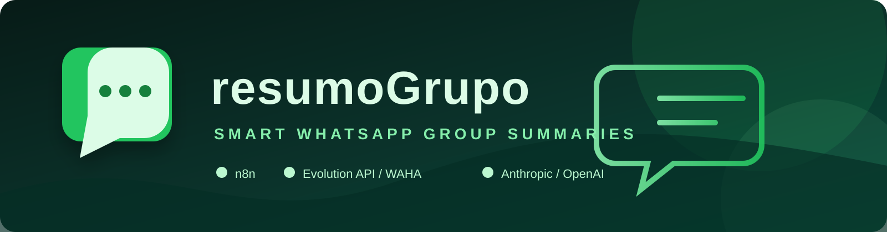

# resumoGrupo — resumo diário e semanal de grupo de WhatsApp via IA

<p align="center">
  
</p>

<p align="center">
  <a href="https://github.com/tiberiolemes/resumo-grupo-whatsapp"></a>
  <a href="LICENSE"></a>
  <a href="https://n8n.io"></a>
  <a href="https://waha.devlike.pro/"></a>
  <a href="https://www.anthropic.com/"></a>
</p>

<p align="center">
  <a href="#pt-br">🇧🇷 PT-BR</a> ·
  <a href="#english">🇺🇸 English</a> ·
  <a href="n8n-workflows/">⚙️ Workflows n8n</a> ·
  <a href="#instalação">🚀 Instalação</a> ·
  <a href="#segurança">🛡️ Segurança</a>
</p>

## PT-BR

Bot que lê as mensagens do seu grupo de WhatsApp ao longo do dia e posta,
num horário definido, um resumo automático com os principais tópicos
discutidos (gerado por IA, um parágrafo por assunto), os links
compartilhados e os participantes mais ativos. Inclui também um resumo
semanal opcional.

Áudios do grupo são transcritos e entram no resumo como texto. A transcrição
também é respondida no próprio grupo, citando o áudio, para quem prefere ler.

Feito com [n8n](https://n8n.io) + um provedor de API WhatsApp não-oficial
(Evolution API por padrão, adaptável pra WAHA ou outros) + Anthropic ou
OpenAI pro resumo de tópicos.

## Pré-requisitos

- Uma instância n8n (**versão 2.7.0 ou superior** — a Data table nativa,
  usada pra guardar as mensagens, só existe a partir dessa versão).
- Um provedor de API WhatsApp não-oficial já conectado com o número que vai
  ficar no grupo (Evolution API é o testado nativamente; veja a seção
  "Adaptar pra outro provedor" se usar WAHA ou outro).
- Uma chave de API da Anthropic ou da OpenAI.
- Opcional: uma chave de API da [Groq](https://console.groq.com) para
  transcrever os áudios (o plano gratuito atende um grupo comum). Sem ela, o
  texto continua funcionando e só os áudios ficam de fora.
- Ser **admin do grupo** de WhatsApp de destino, se o grupo tiver a opção
  "só admins podem enviar mensagens" ativada.

## Instalação

1. **Crie a Data table.** No seu n8n, vá em Data Tables → New Table, nome
   `resumo_grupo_mensagens`, com as colunas:
   - `remetente_nome` (string)
   - `remetente_jid` (string)
   - `texto` (string)
   - `links` (string)
   - `timestamp` (date)

   Anote o ID da tabela (aparece na URL ou nas configurações da tabela).

2. **Importe os dois workflows.** No n8n, Workflows → Import from File,
   importe `n8n-workflows/captura-workflow.json` e depois
   `n8n-workflows/resumo-diario-workflow.json`.

3. **Configure o workflow de Captura:**
   - Abra o node "Filtrar e extrair" e troque `COLOQUE_O_JID_DO_SEU_GRUPO_AQUI@g.us`
     pelo JID real do seu grupo (veja "Como descobrir o JID do grupo" abaixo).
   - Abra o node "Gravar mensagem" e troque `dataTableId.value` pelo ID da
     tabela que você criou no passo 1.
   - Abra o node "Webhook Evolution API" e troque o path
     `TROQUE-POR-UM-PATH-ALEATORIO-SEU` por um valor aleatório e longo, só
     seu (ex: `captura-` seguido de um UUID). **Esse path é a autenticação
     do webhook**: quem não souber a URL não consegue mandar payload falso
     pro seu n8n. Não use um path curto nem adivinhável, e trate essa URL
     como senha.
     Não configure Header Auth aqui. A Evolution API self-hosted **não
     envia headers customizados** no webhook (o campo `headers` existe no
     schema e aceita ser gravado, mas o recurso é da versão Cloud). Se você
     exigir um header que nunca chega, o n8n passa a responder 401 e a
     captura para em silêncio, sem erro visível em lugar nenhum.
   - Nos nodes de áudio: em "Buscar áudio na Evolution API", troque
     `COLOQUE_A_URL_DE_BUSCA_DE_MIDIA_DO_SEU_PROVEDOR_AQUI` por
     `https://SEU_SERVIDOR/chat/getBase64FromMediaMessage/SUA_INSTANCIA`; em
     "Responder transcrição no grupo", troque a URL de envio e o JID como no
     Resumo Diário. Vincule as credenciais do passo 4 nesses dois nodes e no
     "Transcrever na Groq". Veja a seção "Áudios" abaixo.
   - Ative o workflow.
   - Copie a URL de produção do webhook (aparece no node "Webhook Evolution
     API" depois de ativado) e configure no seu provedor WhatsApp pra
     mandar eventos de mensagem recebida pra essa URL.

4. **Configure as credenciais no n8n:**
   - Crie uma credencial do tipo Anthropic API (ou HTTP Header Auth, se for
     usar OpenAI — veja "Adaptar pra outro provedor de IA") com sua chave.
   - Crie uma credencial HTTP Header Auth com o header/valor de autenticação
     do seu provedor WhatsApp (pode ser a mesma do webhook, ou outra, a
     depender de como seu provedor autentica chamadas de envio).
   - Para os áudios, crie outra credencial HTTP Header Auth com o nome
     `Authorization` e o valor `Bearer SUA_CHAVE_DA_GROQ`.

5. **Configure o workflow de Resumo Diário:**
   - Node "Ler mensagens de hoje": troque `dataTableId.value` pelo mesmo ID
     do passo 1.
   - Node "Anthropic - resumir tópicos": vincule a credencial criada no
     passo 4, e edite o prompt (dentro do `jsonBody`) trocando
     `'SEU GRUPO AQUI'` pelo nome/contexto real do seu grupo.
   - Node "Enviar mensagem WhatsApp": troque `COLOQUE_A_URL_DE_ENVIO_DO_SEU_PROVEDOR_AQUI`
     e `COLOQUE_O_JID_DO_SEU_GRUPO_AQUI@g.us` pelos valores reais do seu
     provedor, e vincule a credencial.
   - Nos nodes "Formatar - com atividade" e "Formatar - sem atividade",
     troque `'SEU GRUPO AQUI'` pelo nome do seu grupo também.
   - Ajuste o horário no node "Todo dia às 22h" (Schedule Trigger) pro
     horário que você quiser.
   - Node "Apagar mensagens com mais de 60 dias": troque `dataTableId.value`
     pelo mesmo ID do passo 1. Para guardar por mais ou menos tempo, mude o
     `60` na expressão do filtro.
   - Ative o workflow.

6. **Teste antes de confiar 100%:** mande uma mensagem de teste no grupo e
   confirme que uma linha apareceu na Data table. Depois, rode o workflow
   de Resumo Diário manualmente (Execute Workflow) com o node de envio
   desativado primeiro, confira o texto gerado, e só depois reative o envio
   real.

## Como descobrir o JID do grupo

Cada provedor tem um jeito diferente. Na Evolution API:
```bash
curl -X GET "https://SUA_INSTANCIA/group/fetchAllGroups/SUA_INSTANCIA?getParticipants=false" \
  -H "apikey: SUA_API_KEY"
```
O campo `id` de cada grupo na resposta é o JID (formato
`NUMERO-TIMESTAMP@g.us`).

## Adaptar pra outro provedor de WhatsApp (WAHA)

[WAHA (WhatsApp HTTP API)](https://waha.devlike.pro/) é uma alternativa
open-source à Evolution API. O formato de payload é diferente, então os
dois pontos do bot que fazem parsing/montagem de mensagem (o node "Filtrar
e extrair" na Captura, e o node "Enviar mensagem WhatsApp" no Resumo
Diário) precisam ser ajustados. Achados da pesquisa na documentação
oficial:

**Webhook de mensagem recebida (evento `message`).** A WAHA envia um POST
com este formato:
```json
{
  "event": "message",
  "session": "default",
  "payload": {
    "id": "true_11111111111@c.us_AAAAAAAAAAAAAAAAAAAAAAAAAAAAAAAA",
    "timestamp": 1667561485,
    "from": "11111111111@c.us",
    "fromMe": true,
    "to": "11111111111@c.us",
    "body": "Hi there!",
    "hasMedia": false,
    "ack": 1
  }
}
```
Em mensagens de grupo, `from`/`to` trazem o JID do grupo (formato
`NUMERO@g.us`, igual à Evolution API), e a WAHA usa um campo `participant`
pra identificar o autor individual dentro do grupo (confirmado na
documentação oficial pra eventos de confirmação de leitura; o padrão é o
mesmo usado pelo protocolo WhatsApp em outros eventos de mensagem.
**Teste e confirme no seu ambiente antes de confiar**, já que a doc pública não
traz um exemplo completo de payload de mensagem de grupo com esse campo
preenchido). O nome de exibição do remetente (equivalente ao `pushName` da
Evolution API) não tem um campo documentado de forma clara na doc pública;
o mais seguro é capturar o payload bruto de uma mensagem real do seu grupo
(logue `$json` no node "Filtrar e extrair" antes de fazer o parsing) e
conferir os campos disponíveis (prováveis candidatos: dentro de
`payload._data`, sub-objeto interno do engine).

Ajuste no node "Filtrar e extrair" (troque o corpo do Code node):
```javascript
const GROUP_JID = 'COLOQUE_O_JID_DO_SEU_GRUPO_AQUI@g.us';

const item = $input.first().json;
const payload = item.body?.payload || item.payload || item;

const remoteJid = payload.from;
const fromMe = payload.fromMe;

if (remoteJid !== GROUP_JID || fromMe === true) {
  return [];
}

const texto = payload.body || '';
if (!texto) {
  return [];
}

const urlRegex = /(https?:\/\/[^\s]+)/g;
const links = (texto.match(urlRegex) || []).join(', ');

const remetenteJid = payload.participant || payload.from || '';
const remetenteNome = remetenteJid; // WAHA não documenta um campo claro de
                                     // nome de exibição; ver nota acima

const timestampIso = new Date(payload.timestamp * 1000).toISOString();

return [{
  json: { remetente_nome: remetenteNome, remetente_jid: remetenteJid, texto, links, timestamp: timestampIso },
}];
```

**Endpoint de envio de mensagem de texto.**
```
POST {SUA_URL_BASE_DA_WAHA}/api/sendText
Header: X-Api-Key: SUA_CHAVE
```
Body:
```json
{
  "session": "default",
  "chatId": "COLOQUE_O_JID_DO_SEU_GRUPO_AQUI@g.us",
  "text": "texto da mensagem"
}
```
Ajuste no node "Enviar mensagem WhatsApp": troque a `url` pro endpoint
acima, o `jsonBody` pra usar `session` e `chatId` em vez de `number`, e a
credencial pra HTTP Header Auth com o header `X-Api-Key`:
```javascript
={{ JSON.stringify({ session: "default", chatId: "COLOQUE_O_JID_DO_SEU_GRUPO_AQUI@g.us", text: $json.mensagemFinal }) }}
```

Fontes consultadas (agosto/2026): [WAHA docs: Receive messages](https://waha.devlike.pro/docs/how-to/receive-messages/),
[WAHA docs: Send messages](https://waha.devlike.pro/docs/how-to/send-messages/),
[WAHA docs: Events](https://waha.devlike.pro/docs/how-to/events/),
[waha-docs, events/index.md no GitHub](https://github.com/devlikeapro/waha-docs/blob/main/content/docs/how-to/events/index.md).

## Adaptar pra outro provedor de IA (OpenAI)

O node "Anthropic - resumir tópicos" chama `POST https://api.anthropic.com/v1/messages`.
Pra usar OpenAI em vez disso:
1. Troque a `url` do node HTTP Request pra `https://api.openai.com/v1/chat/completions`.
2. Troque `nodeCredentialType` pra `openAiApi` (ou HTTP Header Auth com
   `Authorization: Bearer SUA_CHAVE`).
3. Troque o `jsonBody` pro formato da OpenAI:
   ```javascript
   ={{ JSON.stringify({
     model: "gpt-4o-mini",
     messages: [{ role: "user", content: "SEU PROMPT + " + $json.textoConcatenado }]
   }) }}
   ```
4. No node "Formatar - com atividade", troque
   `resp.content?.[0]?.text` por `resp.choices?.[0]?.message?.content`
   (a OpenAI retorna a resposta em `choices[0].message.content`, não em
   `content[0].text` como a Anthropic).

## Mensagens enviadas pelo próprio número

O workflow de Captura **grava** as mensagens enviadas pelo número conectado
à instância, e descarta só o que o próprio bot publica, reconhecido pelo
cabeçalho do resumo (`📋 Resumo do dia` e `📅 Resumo da semana`). Sem esse
descarte, o resumo de ontem viraria assunto do resumo de hoje.

Isso serve aos dois cenários. Se a instância é um número dedicado ao bot, as
únicas mensagens `fromMe` que existem são os próprios resumos, então o
resultado é o mesmo de ignorar tudo. Se a instância é o seu número pessoal e
você participa do grupo, suas mensagens entram nos tópicos e no Top como as
de qualquer participante.

Dois detalhes da implementação, no node "Filtrar e extrair":

- A comparação remove os asteriscos antes de comparar, então continua
  funcionando se você mudar o negrito do cabeçalho.
- O descarte só vale com `fromMe === true`. O mesmo cabeçalho colado por
  outra pessoa é mensagem normal e entra no resumo.

Se você mudar o texto do cabeçalho no node de formatação, **mude também a
constante `PREFIXOS_DO_BOT`** no node "Filtrar e extrair", senão o bot passa
a resumir os próprios resumos.

O nome usado nas mensagens próprias é a constante `NOME_PROPRIO`, e não o
`pushName`, que não chega de forma confiável em `fromMe`. Troque
`SEU NOME AQUI` pelo nome que você quer ver aparecer no Top.

## Áudios

A Evolution API não manda o áudio dentro do webhook (com `webhookBase64`
desligado, o padrão), então o workflow de Captura busca a mídia pelo id da
mensagem, envia para a Groq (`whisper-large-v3-turbo`, em português) e grava o
resultado como `[áudio transcrito] <texto>`. No resumo, o áudio vira assunto
como qualquer mensagem.

Em paralelo, o node "Responder transcrição no grupo" publica a transcrição
entre aspas, citando o áudio original, com a assinatura
`_Transcrito por resumoGrupo_`. Se não quiser essa resposta, desative o node;
a gravação no resumo continua.

A resposta só sai para áudio de até 15 minutos atrás (node "Áudio recente?").
Se o provedor ficar horas sem entregar mensagens e depois mandar o acúmulo de
uma vez, os áudios antigos entram no resumo, mas não viram uma sequência de
respostas fora de hora no grupo.

Se qualquer etapa falhar (chave sem crédito, limite da Groq, mídia expirada no
provedor), aquele áudio fica de fora do resumo em silêncio. Mensagens de texto
seguem por outro caminho e não são afetadas.

## Segurança

O node "Webhook Evolution API" recebe eventos de **toda** a instância
WhatsApp conectada ao seu provedor, não só do grupo configurado. O filtro
por JID acontece depois, dentro do n8n. Por isso:
- O workflow de Captura vem configurado com
  `saveDataSuccessExecution: "none"` e `saveExecutionProgress: false`, pra
  não gravar o conteúdo de conversas privadas (inclusive de fora do grupo)
  no histórico de execuções do n8n. Não reative essas opções sem entender
  essa implicação.
- O webhook é protegido por **path secreto**, não por header. Versões
  anteriores deste pacote vinham com `authentication: headerAuth` e o README
  mandava configurar o header no `POST /webhook/set` da Evolution. Isso não
  funciona: a Evolution self-hosted não envia headers customizados, então o
  n8n respondia 401 a todas as chamadas e a captura ficava muda. Se você
  instalou uma versão anterior e o bot nunca gravou nada, é isso.
  Troque o path por um valor aleatório longo e trate a URL como senha.
- Desligar o histórico de execuções tem um efeito colateral que vale saber:
  no n8n, `saveDataSuccessExecution: "none"` faz a execução sumir **inteira**
  da lista, não só o conteúdo dela. Depois disso, a única forma de saber se a
  captura está viva é olhar as linhas gravadas na Data table.
- As mensagens não ficam guardadas para sempre. O node "Apagar mensagens com
  mais de 60 dias" roda junto do Resumo Diário e apaga da Data table o que
  passou desse prazo; os resumos só precisam do dia e da semana. Ele roda em
  paralelo e com `onError: "continueRegularOutput"`, então uma falha na
  limpeza nunca impede o resumo de sair.

## Confiabilidade

Dois ajustes garantem que o resumo diário sempre seja postado, mesmo em
dias sem atividade ou com falha externa:
- O node "Ler mensagens de hoje" vem com `alwaysOutputData: true`. Sem
  isso, quando não há nenhuma mensagem no dia, o n8n interrompe a execução
  ali mesmo e a mensagem de "sem atividade" nunca é postada.
- O node "Calcular estatísticas" descarta o item vazio que essa flag produz.
  As duas coisas andam juntas e **não podem ser separadas**: com
  `alwaysOutputData` ligado e a checagem antiga de lista vazia, um dia sem
  mensagem publicava no grupo um participante fantasma,
  `1. Desconhecido (1 msg)`, em vez do aviso de dia parado. Versões
  anteriores deste pacote tinham exatamente essa combinação.
- O node "Filtrar e extrair" tolera `messageTimestamp` ausente ou malformado.
  Antes, `new Date(NaN).toISOString()` lançava e a captura perdia a mensagem.
- O node "Anthropic - resumir tópicos" vem com
  `onError: "continueRegularOutput"`. Se a chamada de IA falhar (chave sem
  crédito, API fora do ar, etc.), a execução segue e o node "Formatar - com
  atividade" usa o texto de fallback ("Não foi possível gerar o resumo
  hoje.") em vez de derrubar a execução inteira — você ainda recebe os
  links e o Top 5, calculados sem depender da IA.

## Resumo semanal

O pacote inclui `resumo-semanal-workflow.json`, que roda uma vez por semana
(domingo às 9h por padrão) e resume de segunda a domingo, agrupando por
assunto em vez de por dia. A instalação é a mesma do diário: trocar os
placeholders, apontar as credenciais e ativar. Ele lê a mesma Data table, não
precisa de tabela própria.

Se você não quiser o semanal, simplesmente não importe esse arquivo.

## Testando antes de soltar no grupo

Os Code nodes são JavaScript puro e podem ser testados fora do n8n, o que
evita descobrir um erro de formatação com o grupo inteiro assistindo.

O jeito mais simples: abra o JSON do workflow, copie o `jsCode` do node que
quer testar e rode com `node`, passando um `$input` falso. Para os nodes de
formatação, que usam `$now`, instale `luxon` e passe um `DateTime` no lugar.

Antes da primeira execução real, vale mandar o resumo para o seu número
privado em vez do grupo: troque o destino no node de envio, dispare o
workflow uma vez e veja como o negrito, o itálico e os separadores realmente
renderizam no WhatsApp. Só então aponte para o grupo.

## Limitações conhecidas desta v1

- Não captura imagem, vídeo, figurinha nem documento. Texto entra direto e
  áudio entra transcrito.
- Um grupo por instalação (sem suporte multi-grupo nesta versão).
- Se a chamada de IA falhar, o resumo de tópicos vira um texto de fallback
  (ver seção "Confiabilidade" acima) — não há alerta automático avisando
  que isso aconteceu, então vale conferir de vez em quando se o resumo
  ainda está vindo com o parágrafo de tópicos normal.

## Licença

MIT — veja `LICENSE`.

## English

resumoGrupo reads WhatsApp group messages during the day and posts a scheduled AI-generated summary with the main topics discussed, shared links, and the most active participants. It also includes an optional weekly summary.

Voice notes are transcribed and enter the summary as text. The transcription is also posted back to the group, quoting the original voice note, for people who prefer reading.

Built with [n8n](https://n8n.io), an unofficial WhatsApp API provider (Evolution API by default, adaptable to WAHA and others), and Anthropic or OpenAI for topic summarization.

### Prerequisites

- An n8n instance (version 2.7.0 or newer; the native Data Table used to store messages was introduced in that version).
- An unofficial WhatsApp API provider already connected to the number that will be in the group. Evolution API is the provider tested natively; see the WAHA section for an alternative.
- An Anthropic or OpenAI API key.
- Admin access to the target WhatsApp group if only admins are allowed to send messages.
- Optional: a [Groq](https://console.groq.com) API key to transcribe voice notes (the free tier is enough for a typical group). Without it, text keeps working and only voice notes are left out.

### Installation

1. **Create the Data Table.** In n8n, go to Data Tables → New Table and create `resumo_grupo_mensagens` with these columns: `remetente_nome`, `remetente_jid`, `texto`, `links`, and `timestamp`. Record the table ID.
2. **Import the workflows.** Import `n8n-workflows/captura-workflow.json`, `n8n-workflows/resumo-diario-workflow.json`, and, optionally, `n8n-workflows/resumo-semanal-workflow.json`.
3. **Configure Capture.** Replace the group JID placeholder, set the Data Table ID, replace the webhook path with a long random value, enable the workflow, and register its production webhook URL with your WhatsApp provider. For voice notes, set `COLOQUE_A_URL_DE_BUSCA_DE_MIDIA_DO_SEU_PROVEDOR_AQUI` in `Buscar áudio na Evolution API` to `https://YOUR_SERVER/chat/getBase64FromMediaMessage/YOUR_INSTANCE`, set the send URL and group JID in `Responder transcrição no grupo`, and connect the credentials from step 4. The webhook path is the authentication boundary: treat it like a password. Do not add Header Auth to this webhook when using self-hosted Evolution API, because that deployment does not send custom webhook headers.
4. **Configure credentials.** Add your Anthropic or OpenAI credential and the HTTP Header Auth credential required by your WhatsApp provider. For voice notes, add another HTTP Header Auth credential named `Authorization` with the value `Bearer YOUR_GROQ_KEY`.
5. **Configure Daily Summary.** Set the same Data Table ID, connect the AI credential, replace the group name and provider URL/JID placeholders, and choose the desired schedule. Set the same Data Table ID in `Apagar mensagens com mais de 60 dias`; change the `60` in its filter to keep messages for a different period.
6. **Test before enabling real delivery.** Send a test message, confirm it appears in the Data Table, run the daily workflow manually with the sending node disabled, review the generated text, and only then enable delivery.

### Finding the group JID

Each provider has its own method. With Evolution API:

~~~bash
curl -X GET "https://YOUR_INSTANCE/group/fetchAllGroups/YOUR_INSTANCE?getParticipants=false" \
  -H "apikey: YOUR_API_KEY"
~~~

The `id` field returned for a group is its JID, usually in the `NUMBER-TIMESTAMP@g.us` format.

### Adapting to another WhatsApp provider (WAHA)

[WAHA](https://waha.devlike.pro/) is an open-source alternative to Evolution API. Its incoming payload and send endpoint use different field names. Update the `Filtrar e extrair` Code node to read the group from `payload.from`, ignore `payload.fromMe === true`, use `payload.participant` as the author JID, and convert `payload.timestamp` from Unix seconds. Confirm the actual payload in your own environment before relying on undocumented display-name fields.

For text delivery, WAHA uses:

~~~text
POST YOUR_WAHA_BASE_URL/api/sendText
Header: X-Api-Key: YOUR_KEY
~~~

Use a body with `session`, `chatId`, and `text` instead of Evolution API's `number` field. The full payload mapping and JavaScript example remain available in the PT-BR section above.

Sources consulted in August 2026: [WAHA receive messages](https://waha.devlike.pro/docs/how-to/receive-messages/), [WAHA send messages](https://waha.devlike.pro/docs/how-to/send-messages/), [WAHA events](https://waha.devlike.pro/docs/how-to/events/), and the [WAHA documentation repository](https://github.com/devlikeapro/waha-docs/blob/main/content/docs/how-to/events/index.md).

### Adapting to another AI provider (OpenAI)

The default AI node calls Anthropic's messages API. To use OpenAI:

1. Change the HTTP URL to `https://api.openai.com/v1/chat/completions`.
2. Use the `openAiApi` credential type, or HTTP Header Auth with `Authorization: Bearer YOUR_KEY`.
3. Send the OpenAI chat-completions body, for example:

~~~javascript
={{ JSON.stringify({
  model: "gpt-4o-mini",
  messages: [{ role: "user", content: "YOUR PROMPT + " + $json.textoConcatenado }]
}) }}
~~~

4. In the formatting node, read `resp.choices?.[0]?.message?.content` instead of Anthropic's `resp.content?.[0]?.text`.

### Messages sent by the connected number

Capture stores messages sent by the connected number and discards only summaries posted by the bot, identified by their `📋 Resumo do dia` or `📅 Resumo da semana` header. This prevents yesterday's summary from becoming today's topic.

This supports both a dedicated bot number and a personal number used by someone who participates in the group. The own-number display name is controlled by the `NOME_PROPRIO` constant because `pushName` is not reliable for `fromMe` events.

If you change the summary header, update the `PREFIXOS_DO_BOT` constant in `Filtrar e extrair` as well. The comparison removes asterisks before matching, and the discard rule only applies when `fromMe === true`.

### Voice notes

Evolution API does not include the audio in the webhook (with `webhookBase64` off, the default), so Capture fetches the media by message id, sends it to Groq (`whisper-large-v3-turbo`, Portuguese) and stores the result as `[áudio transcrito] <text>`.

In parallel, `Responder transcrição no grupo` posts the transcription in quotes, quoting the original voice note, signed `_Transcrito por resumoGrupo_`. Disable that node if you do not want the reply; the summary keeps the transcription.

The reply is only sent for voice notes up to 15 minutes old (`Áudio recente?`). If the provider stops delivering for hours and then sends the backlog at once, old voice notes enter the summary without flooding the group with late replies.

If any step fails (no credit, Groq limit, media expired at the provider), that voice note is silently left out. Text messages follow a separate path and are not affected.

### Security

The Evolution API webhook receives events from the entire connected WhatsApp instance, not only the configured group; the JID filter runs inside n8n. The Capture workflow therefore disables successful-execution data and execution progress persistence so private conversations are not stored in n8n execution history. Do not re-enable those options without understanding the privacy impact.

The webhook is protected by a long random path rather than a custom header because self-hosted Evolution API does not send custom webhook headers. Disabling execution history also means the whole capture execution disappears from the n8n execution list; use the Data Table rows to confirm that capture is alive.

Messages are not kept forever. `Apagar mensagens com mais de 60 dias` runs with the Daily Summary and deletes older rows from the Data Table; the summaries only need the current day and week. It runs in parallel with `onError: "continueRegularOutput"`, so a cleanup failure never blocks the summary.

### Reliability

The daily summary is designed to keep working on inactive days and during external failures:

- `alwaysOutputData: true` lets the workflow reach the no-activity message when the Data Table is empty.
- The statistics node discards the empty item produced by that setting, preventing a phantom participant from appearing.
- Missing or malformed `messageTimestamp` values no longer abort message capture.
- If the AI call fails, the workflow continues with fallback text while still delivering links and Top 5 statistics calculated without the AI response.

These settings are coupled and should not be separated.

### Weekly summary

`n8n-workflows/resumo-semanal-workflow.json` runs once a week (Sunday at 9:00 by default), summarizes Monday through Sunday, and groups the result by topic instead of by day. It uses the same Data Table. Do not import it if you do not want weekly delivery.

### Testing before releasing to the group

The Code nodes are plain JavaScript and can be tested outside n8n with a mocked `$input`; formatting nodes that use `$now` can be tested with a Luxon `DateTime`. Before the first real run, send the summary to a private number, verify WhatsApp formatting, and only then change the destination back to the group.

### Known limitations in v1

- Images, video, stickers, and documents are not captured. Text is stored as is and voice notes are transcribed.
- One group per installation.
- If the AI call fails, the topic summary uses fallback text and there is no automatic alert. Periodically confirm that normal topic paragraphs are still being generated.

### License

MIT — see `LICENSE`.

[Back to PT-BR](#pt-br) · [Workflows](n8n-workflows/)
